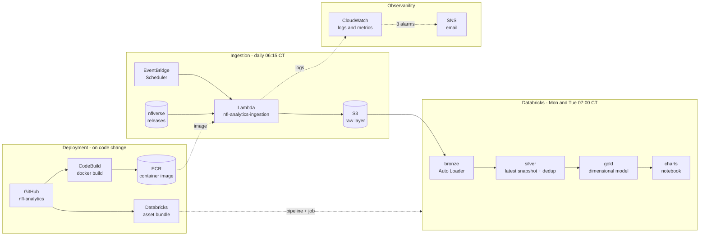
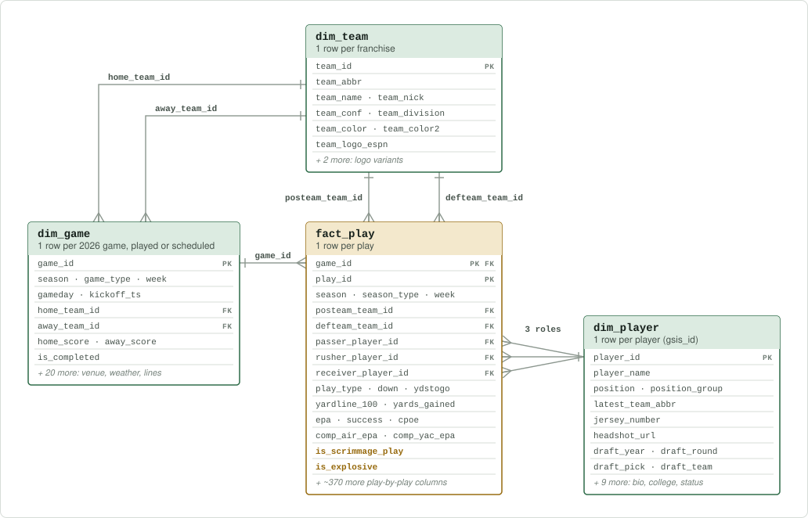
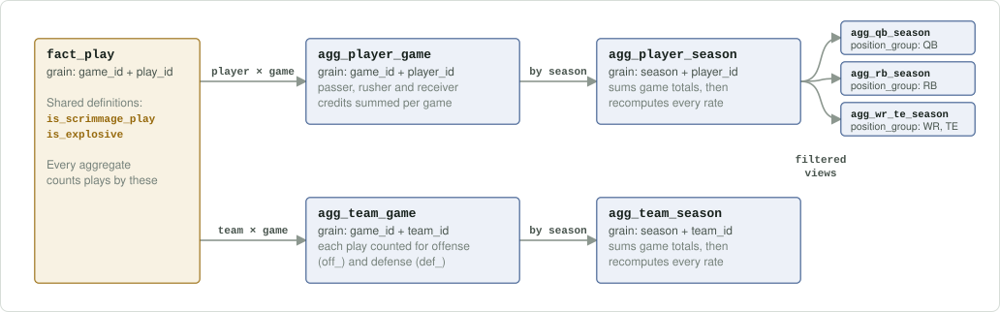

# NFL Analytics Pipeline

Daily ingestion of NFL play-by-play and player data from [nflverse](https://github.com/nflverse)
into an S3 data lake, a Databricks Lakeflow pipeline that models it into bronze, silver and gold
tables, and a weekly job that turns gold into charts.

Ingestion runs as a containerized Lambda, built in AWS, with alerting when it breaks. The
Databricks side is deployed as an asset bundle from `main`.

**Stack:** Python 3.12, Polars, PySpark, Lambda, ECR, CodeBuild, S3, EventBridge, CloudWatch,
SNS, Databricks (Lakeflow Declarative Pipelines, Unity Catalog, Asset Bundles, serverless jobs),
matplotlib

## Architecture



CodeBuild only runs when code changes. The Lambda runs daily and never touches a build. The
Databricks job runs Monday and Tuesday mornings: Monday picks up Sunday's games, Tuesday
picks up Monday night's.

## Repository layout

```
ingestion/        Lambda ingestion: NflAnalyticsDataPull.py, Dockerfile, requirements
pipeline/         The Lakeflow pipeline: bronze.py, silver.py, gold.py
charts/           scatter.py (any SQL query -> scatter chart), nfl_charts.py (the weekly set),
                  weekly_charts.py (the job's notebook), upload_logos.py, mailer.py
resources/        Bundle resources: the pipeline, the weekly job, the logo volume
tests/            Registration test for the silver module
docs/             Diagrams used in this README
databricks.yml    Bundle configuration
buildspec.yml     CodeBuild instructions for the Lambda image
```

## What it pulls

Seven nflverse datasets, written as raw Parquet with no transformation: `pbp` (1999–),
`schedules` (1999–), `players`, `teams`, `nextgen_stats` (2016–), `pfr_advstats` (2018–), and
`participation` (2016–).

Start years differ per source, so a full-history request gets clamped to what each one
actually has. `participation` always trails the current season by a year and only updates
annually, so it's excluded from the daily run.

## Data layout

```
s3://jackc-nfl-analytics-datalake/raw/
  pbp/season=2026/ingest_date=2026-09-26/pbp_2026.parquet
  nextgen_stats/stat_type=passing/season=2026/ingest_date=2026-09-26/nextgen_stats_passing_2026.parquet
  players/ingest_date=2026-09-26/players.parquet
```

Season comes before ingest_date so every snapshot of a season stays together. Datasets that
aren't season-scoped skip that level.

## The Databricks pipeline

One Lakeflow pipeline, `nfl-pipeline`, publishes to the Unity Catalog catalog `nfl`, one
schema per layer.

### Bronze

Twelve streaming tables, one per raw dataset (the Next Gen Stats and PFR stat types each get
their own). Auto Loader reads the raw Parquet as-is and remembers which files it has consumed,
so each run only reads new snapshots. Each row gets `source_file` and `ingested_at` for
auditing. A warn-only expectation, `nothing_rescued`, counts rows whose values didn't fit the
table's schema.

### Silver

Play-by-play and the three tables it joins to: `plays`, `games`, `players` and `teams`. Each
is rebuilt every run the same way:

1. Keep only the latest snapshot: newest `ingest_date` per season for plays and games,
   overall for players and teams.
2. Rank with `row_number()` over the table's key, so no silver table can hold a duplicate key.
3. Winners are typed and get derived columns, then go to the table. Everything else goes to
   the table's quarantine (`silver.plays_quarantine` and so on) with a `quarantine_reason`: `missing_key`, `duplicate_key`
   or `failed_rule`. Between the two, every row of the latest snapshot is accounted for.

Derived columns are mechanical: franchise `team_id`s for every team column (so relocated teams
join correctly), `kickoff_ts` as a real timestamp built from the schedule's Eastern kickoff
time, and drive time of possession in seconds.

### Gold

A dimensional model for reporting and charts, scoped to the 2026 season. Every table is a
materialized view. Green boxes are dimensions, gold is the atomic fact and blue are
aggregates; a crow's foot marks the many side of a join.



`dim_team` plays two roles on every play (offense and defense) and `dim_player` plays three
(passer, rusher and receiver). Games reach `dim_team` again through the home and away team.

The aggregates are built from `fact_play` in two chains, game grain first, then season:



| Table | Grain | What's in it |
|---|---|---|
| `fact_play` | `game_id` + `play_id` | Every play-by-play column, plus `is_scrimmage_play` and `is_explosive` |
| `dim_game` | `game_id` | Teams, scores, kickoff, venue, weather, lines; `is_completed` |
| `dim_team` | `team_id` (franchise) | Current abbreviation, names, division, colors, logos |
| `dim_player` | `player_id` (gsis_id) | Name, position, headshot, bio, draft |
| `agg_player_game` | `game_id` + `player_id` | Passing, rushing and receiving totals and rates |
| `agg_player_season` | `season` + `season_type` + `player_id` | Season totals, rates, target and air yards share |
| `agg_qb_season`, `agg_rb_season`, `agg_wr_te_season` | same as above | One position group each |
| `agg_team_game` | `game_id` + `team_id` | Offense (`off_`) and defense (`def_`) EPA, success, yards, explosives, turnovers; points and W/L |
| `agg_team_season` | `season` + `season_type` + `team_id` | Season totals and rates, point differential, turnover margin |

Each table's join key to each dimension (a dash means it doesn't join to that dimension):

| Table | `dim_game` | `dim_team` | `dim_player` |
|---|---|---|---|
| `fact_play` | `game_id` | `posteam_team_id`, `defteam_team_id` | `passer_player_id`, `rusher_player_id`, `receiver_player_id` |
| `agg_player_game` | `game_id` | `team_id`, `opponent_team_id` | `player_id` |
| `agg_player_season` and the position views | — | `team_id` (latest team) | `player_id` |
| `agg_team_game` | `game_id` | `team_id`, `opponent_team_id` | — |
| `agg_team_season` | — | `team_id` | — |
| `dim_game` | — | `home_team_id`, `away_team_id` | — |

Player stats follow nflverse's own counting rules, so they reconcile with nflverse's published
player stats for 2026, apart from two small differences listed under Known gaps.

### Weekly job and charts

The `nfl-weekly` job runs the pipeline, then a notebook that renders nine scatter charts from
gold, each split into labeled quadrants around the league average with team logos as the
points:

- QB efficiency vs. accuracy (EPA per pass play vs. CPOE)
- QB value from the throw vs. after the catch
- Running backs, wide receivers and tight ends: efficiency vs. consistency, or role vs.
  efficiency
- Team offense vs. defense, by EPA and by success rate, and each side's efficiency vs.
  consistency

The charts show on the run page, and the job's success email links straight to it.
`charts/scatter.py` also works on its own: give it any SQL query and the columns to plot.

## Why it's built this way

### Glue didn't work

This started as a Glue Python Shell job, which looked right for a small non-distributed
script billed at 1/16 DPU. It can't run the code. Python Shell is stuck on Python 3.9 and
nflreadpy needs 3.10+. Pip reports the package as nonexistent rather than flagging a version
conflict, so it took a while to see what was actually wrong.

Glue Spark would have worked with Glue 6.0, as it runs Python 3.11. However this job has no real need
for the overhead that comes with spark code. I skipped it because provisioning a 2-DPU Spark
cluster to make ten HTTP calls and write 15MB is the wrong tool. The finished function runs in under two seconds.

### Container instead of a zip

Polars is too large for Lambda's 250MB zip limit. Containers allow 10GB.

The better reason is that the image pins the runtime and every dependency, so there's no
drift between local and deployed. That bit me early: an outdated local nflreadpy was missing
`load_pfr_advstats` entirely and returned a different shape from `load_teams`. The version is
pinned in requirements.txt now.

### CodeBuild does the building

There's no Docker on my machine and none needed. CodeBuild clones the repo, builds the image,
pushes to ECR, and updates the function. The project has to use EC2 compute with Privileged
enabled; Lambda-backed CodeBuild can't build images because it has no root.

### Images tagged by commit SHA, not `:latest`

Lambda resolves an image to a digest when you deploy it. Push a new image to the same
`:latest` tag and the function keeps running the old one. Tagging by commit gives every build
a distinct URI and ties whatever's running back to a specific commit. A lifecycle policy
keeps the last five images.

### The raw layer is append-only

Each run writes a new `ingest_date` partition instead of overwriting the previous file.

nflverse revises past weeks as stat corrections come in. Overwriting would hide those
revisions and make it impossible to rebuild from a known point. It also keeps Auto Loader
working downstream, since it skips files it has already consumed.

### The bucket comes from the environment

`BUCKET` is an environment variable with no default in the code. That keeps the name out of a
public repo, lets the same image run against different buckets, and fails immediately if it's
missing instead of writing somewhere unintended.

An event payload overrides it, so a one-off run can target somewhere else without editing the
function config.

### The backfill ran locally

Lambda caps a run at 15 minutes and 27 seasons of play-by-play doesn't fit. Rather than
building chunking and checkpointing for something that runs once, I ran it from my laptop
against the same bucket. The script checks whether it's in Lambda and parses the same
parameters as CLI flags when it isn't.

### Empty results warn instead of failing

An earlier version failed the run when a dataset wrote zero rows, which lumps two different
things together.

Asking a source for a season it doesn't cover legitimately returns nothing, and that's
correct behavior. Separately, a source that was queried and came back empty might be a broken
feed or might be a quiet week. Neither is a crash.

So each ingestor returns `(attempts, rows)`. No attempts is a skip. Attempts with no rows logs
`EMPTY_DATASET` and trips its own alarm while the run still succeeds. Real exceptions still
fail the invocation.

### Three alarms

| Alarm | Fires when |
|---|---|
| `Errors > 0` | a dataset threw, the job is broken |
| `EmptyDatasets > 0` | a source went quiet, worth a look |
| `Invocations < 1` | the schedule never fired |

The third treats missing data as breaching because silence is the symptom. The other two
treat missing data as healthy.

### Column types are pinned at ingestion

The first full load put 86% of play-by-play rows into bronze's `_rescued_data`. nflverse
ships `goal_to_go` and `xyac_median_yardage` as integers in some seasons and floats in others,
and Auto Loader won't widen an integer column to fit a float, so it rescues the value instead.
The ingestion script now casts the columns that flip to one type before writing, so every
season's file has the same schema.

### Silver rebuilds instead of merging

A merge only touches keys present in the new data, so a play nflverse deletes would stay in
silver forever. Rebuilding each season from its newest snapshot drops it. The cost is
recomputing the tables each run, which stays cheap because the latest snapshot is picked with
a narrow aggregate and a join before the window runs, not a window over all of bronze.

Bad rows go to quarantine instead of being dropped, so nothing disappears without a record of
why.

### Natural keys in gold

`team_id` is the franchise, `player_id` is nflverse's gsis_id and `game_id` is nflverse's game
ID. They're stable, readable and already conformed in silver, so surrogate keys would add a
lookup without adding anything.

### Season rates come from season totals

The game tables store additive totals, and the season tables sum those and recompute every
rate. Averaging game rates would weight a 3-attempt game the same as a 40-attempt one.

Definitions live in one place: `fact_play`'s `is_scrimmage_play` and `is_explosive` flags.
Change one there and every aggregate follows.

### Deployed as a bundle, from `main` only

The pipeline, job and volume are defined in `databricks.yml` and `resources/`, so the
Databricks side is version controlled and reproducible. The `prod` target runs in production
mode and refuses to deploy from any branch but `main`.

### Charts show on the run page, not in an email

The workspace's serverless compute can't reach the internet, so the job can't download team
logos or send mail. Logos are uploaded once from my laptop into a Unity Catalog volume
(`charts/upload_logos.py`), and the charts are displayed in the job's notebook output. The
job's success email, which Databricks sends itself, links straight to them.

## Components

| Resource | Name |
|---|---|
| S3 bucket | `jackc-nfl-analytics-datalake` |
| ECR repository | `nfl-analytics-ingestion`, lifecycle keeps 5 images |
| CodeBuild project | `nfl-analytics-ingestion-build`, EC2 + privileged |
| Lambda | `nfl-analytics-ingestion`, container, 2048 MB, 900s timeout |
| Schedule | EventBridge Scheduler, `cron(15 6 * * ? *)` America/Chicago |
| Alerts | SNS topic with email subscription |
| Catalog | Unity Catalog `nfl`, schemas `bronze`, `silver`, `gold`, managed storage in S3 |
| Pipeline | `nfl-pipeline`, serverless, triggered by the job |
| Job | `nfl-weekly`, Mon and Tue 07:00 America/Chicago, email on success and failure |
| Volume | `nfl.gold.team_logos`, one PNG per team |

IAM is scoped per resource: the Lambda role reaches one bucket, the CodeBuild role pushes to
one ECR repository and updates one function.

## Running it

### Ingestion

**Deploy:** push to `main`, then Start build in CodeBuild. The build updates the function.

**Invoke** with an event payload, all keys optional:

```json
{}                                        // daily default
{"datasets": "teams"}
{"datasets": "all", "seasons": "2024"}
```

**Locally:**

```bash
pip install -r ingestion/requirements.txt
python ingestion/NflAnalyticsDataPull.py --BUCKET <bucket> --DATASETS teams
```

Full backfill, which won't fit in Lambda's timeout:

```bash
python ingestion/NflAnalyticsDataPull.py --BUCKET <bucket> --SEASONS all --DATASETS all
```

A default run takes about two seconds and peaks around 250MB. Memory is provisioned well
above that because Lambda scales CPU with memory and the cost difference is negligible.

### Databricks

From `main`, with a Databricks CLI profile:

```bash
databricks bundle validate -p <profile>
databricks bundle deploy -p <profile>
python charts/upload_logos.py --profile <profile>                  # once, after the first deploy

databricks bundle run nfl_weekly -p <profile>                      # pipeline, then charts
databricks bundle run nfl_weekly --only charts -p <profile>        # charts from current gold
```

### Charts on a laptop

Queries run on a SQL warehouse, signed in with the same CLI profile:

```bash
pip install -r charts/requirements.txt
export DATABRICKS_CONFIG_PROFILE=<profile>
export DATABRICKS_WAREHOUSE_ID=<warehouse id>

python charts/nfl_charts.py                       # all nine, to charts/output/
python charts/nfl_charts.py --chart team_epa      # just one
python charts/scatter.py --sql "SELECT team_abbr, team_logo_espn, off_epa_per_play, def_epa_per_play
                                FROM nfl.gold.agg_team_season WHERE season = 2026" \
    --x off_epa_per_play --y def_epa_per_play --image team_logo_espn --invert-y
```

Player charts qualify players by plays per game their team has played, so the bar rises as
the season goes on. Override with `--qb-per-game`, `--rb-per-game`, `--wr-per-game` and
`--te-per-game`.

## Known gaps

`pfr_advstats` have genuinely different schemas — passing, receiving and rushing share only
11 of 29/23/22 columns — so each needs its own bronze table rather than a union.

**Participation, Next Gen Stats and PFR stop at bronze.** Silver models play-by-play and the
tables it joins to; the rest waits until those are settled.

**AWS infrastructure is console-created, not code.** The ingestion side was built by hand in
the AWS console, so it isn't reproducible or version controlled. The Databricks side is in the
bundle; defining the AWS side in Terraform is the obvious next step.

**The schedule should be off in the offseason.** nflverse stops changing after February, and
once the season rolls over the empty-result notifications start.

**Two small differences from nflverse's player stats.** Yards after a lateral are credited by
nflverse to the player who caught the lateral and aren't here. EPA matches exactly for most
players and within about 2 for the rest, because nflverse's stats build values a few plays
slightly differently.

**Gold covers 2026 only.** Adding a season to `GOLD_SEASONS` in `gold.py` backfills it.

**Testing is thin.** There's a registration test for the silver module, but no data tests yet.
The quarantine tables and the `nothing_rescued` expectation are the main checks on data
quality.

## Next

- Terraform for the AWS side.
- A GitHub Actions workflow that deploys the bundle with a service principal on merge to
  `main`.
- Alerts on the quarantine tables, so a spike in bad rows doesn't wait to be noticed.
